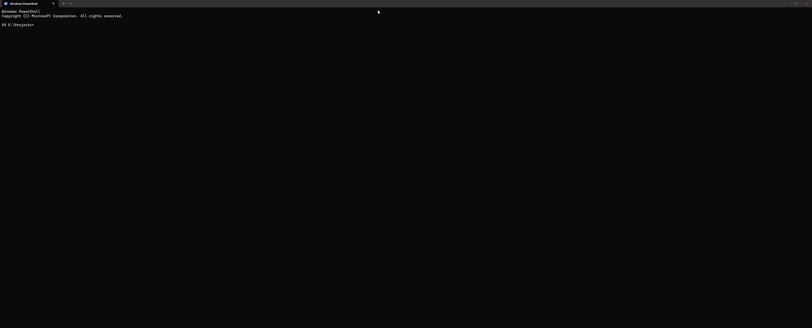

# PaneTag

[](https://www.powershellgallery.com/packages/PaneTag)
[](https://github.com/WaelT/PaneTag/actions/workflows/smoke.yml)

Persistent title bars for Windows Terminal panes. The bar stays put while you run
full-screen and interactive apps such as `claude`, `codex` or `edit`, so you can always
tell which pane is which.



Each bar shows your title on the left and the running app's own title on the right.

Windows Terminal has no per-pane titles of its own, and apps overwrite the tab title.
PaneTag reserves one row of the pane for a bar that apps can't draw over.

## Quick start

```powershell
Install-Module PaneTag -Scope CurrentUser
```

Or from source: `git clone https://github.com/WaelT/PaneTag.git`, then `.\install.ps1` in
the clone (builds the helper with the C# compiler built into Windows; no SDK needed).

Then, in any new pane:

```powershell
ptag 'Backend API'         # add a bar (starts a fresh shell under it)
ptag 'Backend (debug)'     # rename it
claude                     # the bar stays
exit                       # remove the bar
```

To rename while claude is running, use a `!` command in Claude Code:

```
! ptag Reviewing PR
```

`ptag` is the same command in every shell inside a titled pane (PowerShell, cmd, Git Bash).

## Running several Claude Code agents?

Let the bars tell you which one needs you:

```powershell
Enable-PaneTagClaudeHooks
```

When Claude finishes, its bar turns **orange** (`● Your turn`); when it asks for permission,
**red** (`● Needs you`). It goes back to normal as soon as you type in that pane.
See [Claude Code integration](docs/usage.md#claude-code-see-which-agent-needs-you).

## Top or bottom?

The bar goes on **top** by default. Windows Terminal only keeps lines that scroll off screen
when the scrolling area starts at the top row, so with a top bar **you lose scrollback**.
If you scroll back through long Claude Code sessions, use a bottom bar:

```powershell
ptag 'Backend API' -Position Bottom
$env:PANETAG_POSITION = 'bottom'   # in your $PROFILE, to make it the default
```

## Documentation

| Document | What's in it |
| --- | --- |
| [docs/usage.md](docs/usage.md) | Full command reference, colors, Windows Terminal profiles, key bindings and layout scripts |
| [docs/architecture.md](docs/architecture.md) | How it works: pseudo console, escape-sequence rewriting, threads, pipe protocol |
| [docs/troubleshooting.md](docs/troubleshooting.md) | Common problems and fixes |
| [docs/development.md](docs/development.md) | Building, testing and changing the code |
| [CHANGELOG.md](CHANGELOG.md) | Release history |
| [AGENTS.md](AGENTS.md) | Instructions for coding agents working on this repo |

## Requirements

- Windows 10 1809 or later (Windows 11 recommended)
- Windows Terminal (other terminals that support standard escape sequences should work, untested)
- Windows PowerShell 5.1 or PowerShell 7
- .NET Framework 4.x (built into Windows)

## Limitations

- Apps get one row less than the pane.
- With a top bar, lines that scroll off screen are not kept in scrollback (see above).
- Mouse clicks on the bar are not passed to mouse-aware apps.
- Emoji and East Asian characters in titles are measured approximately; the bar is still painted full width.

## License

[MIT](LICENSE)
